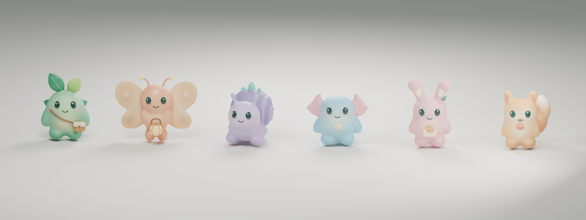

# Pocket Realm

A native iPhone AR adventure with nine original Blender characters. First scan your room: Muse interprets its layout and snapshots, plans wall decorations for the selected theme, and plans both quest locations. Review the room plan, explore, meet your friend, and recover a glowing keepsake. Nibbi, Cindlet, and Bloopi then play an interactive puzzle with you; solving it earns a saved friendship badge.



| Friend | Personality | Quest | Badge |
| --- | --- | --- | --- |
| **Mosskip** | A mint-green sprout courier with a leaky seed satchel | Find a lost dew seed | Sprout Scout |
| **Glimlo** | A bashful peach moth with petal wings and a tiny lantern | Recover a lantern spark | Little Light |
| **Pebblin** | A sleepy lilac pebble snail with a crystal shell | Bring back a runaway dream pearl | Dream Keeper |
| **Bloopi** | A blue tide pup with rosy gills and a paddle tail | Speak fluent Bloop: copy three growing bubble/wiggle/plop patterns | Puddle Pal |
| **Nibbi** | A strawberry bunny baker with floppy ears and a cookie pocket | The impossible snack: mix three ingredients satisfying the recipe clues | Cookie Comrade |
| **Cindlet** | A honey-colored ember fox who keeps small wishes warm | Too hot for toast: combine ember treats to reach exactly the target warmth | Cozy Guardian |
| **Pufflo** | A periwinkle cloud whale with soft lavender flippers | Recover a drifting cloud bell | Cloud Captain |
| **Trufflet** | A shy mushroom story keeper with a spotted cap and a pocket book | Find the missing spore bookmark | Story Sprout |
| **Dottli** | A butter-yellow duckling florist with a daisy on their head | Bring back the bouquet's sun button | Petal Pal |

All character geometry and materials were authored for this project in Blender. No external character models or textures are used. The app bundles the actual USDZ exports; portraits are Blender renders of those same models. One chosen friend appears per scan. You can tap them to pet, play together, hear their greeting, complete their quest, and chat afterward. The nine-card roster also opens a camera-free preview with Hello, Pet, Play, and Celebrate buttons; drag the preview to turn the model. Nibbi, Cindlet, and Bloopi also have **Try the quest · no camera needed**, using the same puzzle rules and controls as AR. Practice never awards badges. Mosskip, Glimlo, Pebblin, Pufflo, Trufflet, and Dottli have find-and-return quests in this first release of interactive games.

## Playing the new quests

The in-room quest lives in a bottom drawer. Walking objectives start tucked away with a short clue and distance; tap the header or swipe it up for details, and swipe the header down to see more of your room. Hello, Collect, and Give/Play stay available when you're close enough, even with the drawer tucked away. Puzzle choices scroll separately from the handle, with the submit/replay and Hint buttons pinned below. Tucking away a puzzle keeps your choices and completed verses; Bloopi's interrupted demonstration waits for a replay when you reopen it. The camera above the drawer stays interactive.

Find the character, say hello, collect their keepsake, and return. **Let's play together** opens the puzzle beside the character. A successful answer automatically celebrates, displays a little cookie/toast/bubble reward in AR, and saves the existing friendship badge once. Stay to pet or chat, or choose **Meet another friend**.

- **Nibbi:** select three different ingredients from six. Their visible flavor tags must cover all three recipe traits without the forbidden flavor. Any valid combination wins. Taste tests explain missing flavors or the unwanted ingredient; tap a selected ingredient to remove it.
- **Cindlet:** toggle 1-, 2-, 3-, and 5-warmth treats, using each once. The meter updates immediately. **Try the oven** checks the exact target (8 or 9), with warmer/colder feedback and a removable selection after mistakes.
- **Bloopi:** **Watch verse** demonstrates a sequence with matching button highlights and distinct character moves. Repeat two, then three, then four moves. Wrong moves retry only the current verse. Replays are unlimited; **Hint** slows demonstrations and names the next answer.

There is no countdown or lives limit. Recipe/math hints become explicit solutions when needed. Walking away, losing tracking, or backgrounding preserves choices and completed verses for the active encounter; an interrupted Bloopi demonstration can be replayed. Rescanning, choosing another friend, or quitting the app resets puzzle progress. Badges and the latest saved room persist across launches.

The direct AI request includes the full room plan and a friend-specific puzzle schema. The selected model selects one of two validated puzzle variations for the selected interactive friend and writes a short story introduction in the same room-plan response. The app owns all rules, solutions, hints, and win checks; it makes no extra provider calls during play. The shared `Tests/Fixtures/quest-plans.json` checks Swift/Python blueprint compatibility. The optional proxy supports the same puzzle catalog through `questVersion: 1`. The planned word, dream, garden games and six-friend picnic finale are future work.

## Save a room and reuse it

After a successful scan and AI plan, the app automatically saves the latest room once ARKit has enough tracking detail. The room review reports whether it is saved or needs another look around. **Save room** in the adventure menu retries a failed save. A new scan replaces the saved copy only after the new plan and world map have been saved successfully.

On the welcome screen, choose a friend and tap **Use saved room**. Look at the same walls and furniture from roughly the original scanning position. ARKit restores the saved coordinate frame; only after normal tracking and the saved reference anchor remain present for a full second does the room review unlock. Themes, character locations, and keepsake locations then reuse the saved plan, with no AI call or server connection. When choosing a different friend, the app keeps the spatial plan and uses that friend's authored greeting and puzzle rather than reusing the original friend's dialogue.

This first version stores one room, locally in Application Support, excluded from device backups. It contains RoomPlan geometry, the ARKit world map, placement transforms, geometry/depth observations used for foliage, and the validated AI plan. It does not save the camera JPEGs, credentials, or active puzzle progress. **Room options → Forget saved room** removes the stored copy; existing badges remain. **Room options → Scan a new room** makes a fresh plan.

Recognition may take longer if lighting or furniture has changed. Nothing is placed while recognition is incomplete. **Try recognizing again**, **Back**, and **Scan a new room** remain available; no timeout silently starts another paid generation. The first scan still needs the selected provider’s key and an internet connection. A scan made before this update needs to be captured once more to create a saved map.

For feature testing during a session, use **Adventure options → Replay this room** or **Try another friend in this room**. These reset only the encounter and reuse the measured room, placements, and original AI plan. They make zero API calls and keep the current AR coordinate frame, so no new scan or relocalization is needed. Themes, animations, and authored puzzles can be tested repeatedly. Returning to the original friend preserves their generated dialogue and puzzle. After closing or rebuilding the app, use **Use saved room**; wait for “Room saved” before exiting the first time, and keep the installed app's data (uninstalling deletes the room). A fresh room or a new AI-generated plan still needs an AI request.

Device check: scan and wait for “Room saved”; close the app, turn off internet access, reopen, and use the saved room. Check that placements match, switch to another friend without AI traffic, and try from a different room to verify it waits for recognition. This physical alignment check cannot be replaced by simulator tests.

## Connect Muse on your iPhone

Muse is now the default AI provider for everything previously handled by Gemini: room understanding, wall-decoration layouts, discovery and keepsake choices, clues, greetings, puzzle selection, and puzzle introductions. Open **Connection settings** (the welcome-screen gear), leave **Provider → Muse** selected, choose **Muse Spark 1.3**, and paste your **Meta Model API key** into **Muse API key**. Tap **Save key without testing**, then **Done → Scan my room**. **Save & Test** makes one small real request if you want to check your credentials first. The test can be cancelled and stops after 60 seconds.

The Muse implementation is isolated in `PocketRealm/Core/MuseClient.swift` and `PocketRealm/AR/MuseKeyStore.swift`. It uses Meta's [Chat Completions endpoint](https://dev.meta.ai/docs/protocols/chat-completions), [structured JSON output](https://dev.meta.ai/docs/structured-output), and base64 image messages. Authentication uses your [Meta Model API key as a Bearer token](https://dev.meta.ai/docs/authentication). No additional SDK or Mac server is needed. Spark 1.2 and 1.1 are also selectable for accounts with access to those models.

`PlanningClient` routes the entire request to the selected provider. `RoomPlanRequest` owns the common prompt, JSON schema, and local validation, so either provider must return valid measured furniture IDs, wall treatments, and supported puzzle blueprints. There is no automatic request to Gemini when Muse fails. An error retains the scan for manual retry; there are no automatic paid retries. The provider and model selections persist without storing credentials in preferences.

Muse and Gemini keys use separate iPhone Keychain services with `WhenUnlockedThisDeviceOnly` protection. A key is never bundled, logged, or included in a saved room. The secure field clears after saving, switching providers, or closing settings. **Remove API key** removes only the selected provider's credential. The existing Gemini client remains separately available through **Provider → Gemini**; its previous saved key is preserved.

Tests and new room plans use the selected model. Saving a key, switching models, and switching providers make no network requests. Scanning sends measured geometry and up to six snapshots directly to the selected provider. Muse uses `https://api.meta.ai/v1/chat/completions`; Gemini uses Google's Interactions endpoint with `store: false`. Muse rejects redirects and ignores provider error bodies. Existing saved rooms, replay, and gameplay work without another AI call. Reusing a previously saved Gemini room keeps its cached plan; **Scan a new room** generates a new Muse plan.

This direct connection is for a personal prototype using your own key. A distributed app should keep a shared developer key behind a backend. The optional Gemini proxy below is a separate legacy development path; the current iPhone UI calls the selected provider directly.

## Optional Gemini server

The server requires Python 3.10+ and a Gemini API key. It uses the standard library; no dependency installation is needed. Keep the key in your terminal environment, not in the app, source code, or chat.

Double-click `server/start.command` in Finder, or run it from this repository:

```sh
./server/start.command
```

Paste your key into the hidden prompt and press Return. The launcher keeps it in the server's process environment, never in a file or shell history. Keep the Terminal window open while playing; Control-C stops the server. If `GEMINI_API_KEY` is already configured, you can also run `python3 server/server.py` directly.

The default port is 8787. The model is pinned to `gemini-3.6-flash`; override it with `GEMINI_MODEL` if your account uses another compatible model. Google lists a [free tier for Gemini 3.6 Flash](https://ai.google.dev/gemini-api/docs/pricing), subject to your project's quota. The server uses Gemini's Interactions API with a constrained JSON schema.

Find your Mac's local hostname in another terminal:

```sh
scutil --get LocalHostName
```

If this prints `Colins-MacBook`, the proxy's base address is `http://Colins-MacBook.local:8787`. Local clients must share its network and have local-network permission. Allow incoming Python connections in the Mac firewall if prompted. The current app plans rooms directly with its selected provider; this address can be entered separately under **Drawing workshop** to use the drawing service.

`GET /health` reports whether the server is running, whether a key is configured, the selected model, and `planningVersion: 3`. Its `lastRequest` receipt and the Terminal log show upload size, snapshot/furniture/surface counts, provider attempts, and the last processing stage. They never include photos, room descriptions, prompts, or credentials. `scan_received` confirms the Mac parsed the scan; `sending_to_gemini` records the outgoing attempt; `gemini_responded` records an HTTP 200; `plan_ready` confirms a complete validated plan. A provider error includes its HTTP status. Restart the server after updating its code; version 3 uses a wall-only Jungle plan and requires the updated app and server together. Health does not itself test the provider or reveal the key. The default server listens on the local network for hackathon testing, has no authentication, and should not be exposed to the public internet without authentication and rate limiting.

## Run the iPhone app

1. Open `PocketRealm.xcodeproj` in Xcode.
2. Select your development team under **Signing & Capabilities** if needed. Existing team settings are preserved.
3. Connect your LiDAR-equipped iPhone Pro, select it as the destination, and Run. The app targets iOS 17+.
4. Save your Gemini key in **Connection settings**, choose a friend and theme, then tap **Scan my room** and allow camera access.
5. Slowly turn all the way around. Include visible walls and furniture; move enough to see the objects clearly. The progress bar measures viewing directions, not geometric completeness.
6. The scan finishes automatically once all 24 direction sectors have been observed, at least one usable furniture location is detected, and at least 12 seconds have elapsed. If the sweep is complete but no locations appear, keep looking at a cabinet, table, sofa, chair, bed, or refrigerator.
7. The app finalizes the room model and sends measured surface polygons, furniture, candidate locations, and up to six downsized snapshots labeled with camera positions and viewing directions. The selected AI returns a room summary, decoration density for each wall, and friend/keepsake locations. A failed request retains the scan for retry; exploration does not begin with a partial plan.
8. Review **Your room, understood**. Your selected theme is applied now; **Choose a room theme** lets you switch from Original. Expand **Where the adventure happens** to inspect the placement reasoning. Tap **Start exploring**, then follow the clue. First be at least 1.8 m from the chosen spawn point, then approach within 1.4 m for 0.8 seconds. If the spot was next to you when scanning finished, step back first. Tracking must be normal and the anchor resolved.
9. Your friend appears automatically and remains at that world position. Tap **Say hello** to hear the generated greeting and begin their quest. **Pet** triggers a happy wiggle.
10. Find the glowing keepsake by the furniture chosen by the selected AI. Approach within 1.3 m and tap **Collect**. The selected AI must choose a different supported furniture location when available; with only one usable location, the item floats just above your friend.
11. Return within 2 m of your friend. For Nibbi, Cindlet, or Bloopi, tap **Let's play together** and solve their puzzle. For the other friends, tap **Give it**. Their friendship badge is saved on the device; repeat completions cannot award it twice. You can then **Chat**, **Pet**, or **Meet another friend**.
12. Use **Scan again** to make a new room plan, or **Choose another friend** to return to the roster and reuse the saved room. Saved badges survive both actions; the last good room remains until a new one is saved or you forget it.

Distances use the horizontal floor plane. Friends stand on roomy tabletops and low cabinet tops, or on measured floor beside other furniture. Their feet sit about 8 mm above the support with at most 1 cm of idle bobbing; deliberate reaction hops land back on the same surface. They do not follow moving furniture or a moving cabinet door. Opening detection is not implemented. Keepsake locations reuse supported furniture locations and never require opening furniture. Friends remain visible after discovery, even when you move away. Collecting, puzzle input, and turning in require valid tracking and resolved anchors.

## What is automatic

- **RoomPlan:** detects floor/wall polygons, doors, windows, openings, furniture categories, and bounding boxes during the sweep.
- **ARKit:** measures the room and maintains a single world coordinate frame throughout scanning, generation, and play.
- **Muse (or the selected provider):** first interprets the room from geometry and snapshots. One response contains the room summary, Jungle palette, shared per-wall decoration density, both quest locations, placement reasoning, clue, and greeting. It chooses only supplied surface/furniture IDs and cannot supply arbitrary coordinates.
- **The app:** validates the complete plan, renders its treatments on measured surfaces, and displays the review. After **Start exploring**, it anchors the friend to a supporting surface and the keepsake just above its chosen location; the creature reveals when proximity conditions are met.

The scan uses `RoomCaptureSession(arSession:)` with the same session as the RealityKit `ARView`. Scan completion calls `stop(pauseARSession: false)` and does not reset tracking. Results are finalized with `RoomBuilder`; the app uses native transforms directly, without exporting/reimporting USDZ.

Furniture with low classification confidence is excluded, as are stairs, appliances such as stoves/ovens, and other unsupported categories. Placement uses RoomPlan geometry and a side observed from a camera position during the scan. Table/low-cabinet placements stay 27 cm inside their edges; other categories require a scanned floor polygon with room for the support footprint. Locations occupied by other scanned furniture are excluded. A downward ARKit raycast against bounded horizontal planes refines height by at most 12 cm, so a tabletop cannot snap to the floor below. If ARKit has no matching plane, the measured RoomPlan surface remains the support. This is approximate surface placement, not a free-space/navigation solver; check placement in the demo room. Saved rooms recompute support points from their stored geometry after an update, then refine them only after relocalization. A saved room without the required supports needs a clearer scan.

Broad snapshots include camera positions and forward vectors in the same coordinate frame as the measured room. They are not object-labeled crops. The selected model is instructed to describe uncertainty and avoid guessing which image detail belongs to which ID.

## Room themes

Tap **Room theme** on the welcome screen, or **Theme** while scanning or playing, to choose **Original**, **Jungle**, **Coral Reef**, **Crystal Cavern**, or **Woodland**. Jungle adds vines, blooms, and ferns; Coral Reef adds rose coral fans, hollow tube sponges, and golden kelp; Crystal Cavern adds amethyst geodes, smoky quartz, and copper-bearing rock; Woodland adds turkey-tail and oyster mushrooms, bark, and ferns. All decorations attach to visible wall patches. Floors and furniture remain uncovered. Your selection is saved on the device. The theme waits for the complete AI room plan; switching afterward reuses that plan and leaves the friend, quest, and badges in place.

The 360° sweep supplies measured geometry and up to six snapshots to the selected provider. It chooses no/light/lush decoration density for every usable wall, plus a forest or tropical palette for Jungle. The other themes use their own authored materials. Floor geometry remains room context but has no decoration treatment. The shared layout is generated even when Original is selected. The existing `room.jungle` / `vines` wire fields retain their names for saved-room and proxy compatibility; the prompt now describes their use across all themes and asks for a theme-neutral design note. This uses sampled frames rather than a recorded 360° video.

The app retains up to 72 local camera observations (intrinsics, poses, and 64×48 depth samples when available). A decoration's entire bounding footprint must fit inside a measured wall polygon and observed camera views, with a 7 cm placement-check grid. Depth must support the wall within 20 cm, when available; low-confidence samples are rejected. Sightlines also reject intervening measured walls and furniture. Full model footprints keep a margin around doors, windows, openings, furniture, and quest spots. These are conservative, approximate checks; unclassified objects and scan errors can still affect placement. ARKit mesh occlusion supplements the placement checks and remains enabled for characters in every theme. Decorations hide while tracking is limited or lost.

The six original Blender USDZs have curved, smooth-shaded leaves with fine thickness, tubular stems, petal geometry, and 1024px leaf color/roughness textures. The nine additional Blender models use 1024px base-color and tangent-normal textures, curved coral and sponge geometry, beveled mineral facets, mushroom gills, and textured bark. Each cluster is one model with no more than four material batches. Each new asset stays below 36,000 triangles; the manifest records exact counts. Runtime placement caps the scene at 20 clusters and a conservative 350,000-triangle budget, reusing model resources. Low-confidence and curved walls are skipped. Without a usable viewed wall patch, the app asks for more open wall space; it never invents floor coverage. Rescanning clears the active geometry and observation/depth data. The last successfully saved room remains on the device until replaced or forgotten.

On a LiDAR device, scan visible wall areas without deliberately aiming at the floor. Check doors, windows, furniture occlusion, and close-up leaf silhouettes; toggle Reef → Cavern → Woodland → Original → Reef to confirm each model set changes and returns to stable placement. Rescan to check old decorations disappear, and test background/resume tracking. Studio previews verify the asset geometry and materials, but live room placement still needs a fresh scan in the updated app.

Validation includes the shared Swift/server JSON contract, mandatory review, surface IDs, quest locations, camera frustums, depth occlusion, rotated furniture sightlines, and complete foliage footprints. `scripts/validate_jungle.swift` loads all six exported assets in RealityKit to verify orientation, scale, mesh count, and imported leaf textures. `scripts/validate_themes.swift` loads all nine additional models and checks their scale, orientation, material count, and imported base-color/normal maps. Catalog tests compare runtime budgets and asset filenames with the export manifest.

## Reliability and privacy

- The app and server validate returned IDs, treatment choices, complete surface coverage, distinct quest locations, and text lengths. No theme is applied and no quest begins before a valid room plan returns.
- Old generation results cannot populate a restarted scan; requests are cancelled and tied to a scan generation ID.
- Leaving the reveal radius or losing tracking clears the proximity dwell timer.
- Room saves atomically bundle a validated plan, geometry, and a secure ARWorldMap archive. Restoring never calls an AI provider, and no old positions are revealed before the saved coordinate frame is recognized.
- Backgrounding during scanning requires a fresh scan on return. During gameplay, the app attempts to resume tracking. **Scan again** is the recovery path if relocalization fails.
- Network/provider failures offer a manual retry using the same captured geometry and snapshots. The direct client does not automatically retry provider errors. The optional proxy has bounded retries for HTTP 500/503 and explicit Gemini model fallback when configured. The direct clients have no silent local or cross-provider fallback.
- Camera frames are sampled into at most six JPEGs with a maximum dimension of 640 pixels. They are held in memory and discarded after successful planning or rescan. Room data and images go directly to the selected provider over HTTPS. Gemini requests use `store: false`; provider-wide retention policies still apply.
- The iPhone reads your API key from its Keychain. The optional proxy separately reads `GEMINI_API_KEY` from its environment or the git-ignored `server/.env` file; exported variables take precedence.

## Sketch quests: drawings come to life

Paper drawings become things in the game. Codex looks at each drawing, sculpts it in Blender, and decides how it behaves.

In **Connection settings → Drawing workshop**, enter the workshop's HTTPS URL (or a local HTTP address on the same network). `ADVENTURE_SERVER` can provide a build-time default; an address entered by the user is preserved. The drawing workshop is separate from room planning: Gemini/Muse still run directly from the iPhone, and the workshop does not require its own Gemini key to make drawings.

**Drawing challenges** is enabled by default but only adds traps when a workshop address or saved creation is available. Without either, the existing pickup-and-return quest works as before. Turn it off in settings to play without traps. During any trap, **Continue without a drawing** frees the keepsake if generation fails or you want to move on. After returning it, Nibbi, Cindlet, and Bloopi still run their existing interactive puzzles before awarding the badge.

- **Sidekick.** On the welcome screen, **Draw a sidekick**: anything at all. When it's ready it stands on your room's floor, trots after you, and faces you when idle. Tap it, or **Talk**, to hear its lines.
- **Traps.** After you greet your friend, their item is stuck in one of six random predicaments: moon-ice, a grumpy storm cloud, thornvines, a snoring boulder, a wobbly bubble, or a shadow puddle. Each has an open-ended drawing hint ("draw something that could thaw it, crack it, or politely ask the ice to let go").
- **Your solution.** **Draw a solution** overlays a page-shaped guide on the live AR view, so tracking keeps running, and captures the frame. While Codex works, the card cycles through workshop updates ("The gnomes are arguing about the color. Your drawing wins."). The result is one of three kinds:
  - a **tool**, which appears in your hand;
  - a **character**, which pops in beside the trap, faces you, and talks;
  - an **object**, which drops in nearby.

  Tap its action button (e.g. **Knock! (2 to go)**) or the trap itself until the trap bursts. Then collect the item and return it as before.
- **Inventory.** Every finished drawing is saved on the phone. Reuse one on a later trap (no new Codex job) or make it your sidekick.

The app uploads a cropped JPEG (≤1024 px) to `POST /drawings` with `purpose` (`sidekick` or `challenge`), the trap description, and the friend. It polls `GET /drawings/<id>` and downloads `GET /drawings/<id>/model.usdz`. A ready status includes the **card** Codex chose: `kind`, `verb`, `uses` (1–5), `title`, `arrival`, `success`, `lines`, and `voice`. The server sanitizes all of it before the app speaks it.

On the server, `server/drawing_worker.py` takes one job at a time. It copies `server/drawing_kit/` into a fresh job folder: `AGENTS.md` has Codex's instructions, and `kit.py` is the Blender helper. It also writes the game situation to `QUEST.md`. Then it runs `codex exec --sandbox workspace-write` with the drawing attached. Codex writes `build.py`, runs Blender headless, checks the Cycles preview, and calls `kit.finish(...)`. That exports `model.usdz` with the friends' USD settings and records the card. The worker requests a workspace-write sandbox for the job. Text in a drawing is treated as artwork. Jobs time out after 7 minutes; completed/failed jobs are pruned after 24 hours when the worker is idle. Generation time depends on the drawing and worker load.

The worker needs a logged-in Codex CLI and Blender 5.2 at `/opt/blender/blender` on the same machine; the web server only needs a shared `JOBS_DIR`. Run the HTTP server and worker with the same absolute `JOBS_DIR`, for example in separate terminals:

```sh
JOBS_DIR="$PWD/server/jobs" python3 server/server.py
JOBS_DIR="$PWD/server/jobs" python3 server/drawing_worker.py
```

A VPS deployment can run the worker as a systemd service and mount that same jobs folder into the web container. Restart both services after updating; the iPhone merge does not deploy the worker automatically.

## Reusing rooms while testing drawings

Use the existing **Use saved room** and **Replay this room** actions to test drawings without another scan or AI plan. The validated saved-room format, world-map reference-anchor gate, wall observations, and cross-friend puzzle selection remain shared with the normal game. Sidekicks appear only after room recognition and Start exploring. Replaying, rescanning, or leaving an encounter cancels its pending trap drawing and removes its helper; saved creations remain reusable.

## Gemini model fallback

`GEMINI_MODEL` is tried first. If `GEMINI_FALLBACK_MODELS` (comma-separated) is set, a failing (500/503), over-quota (429), or slow model (over 25 s) hands off to the next model in the list, within the shared 55-second request budget. Duplicate model names are tried only once. Busy Flash models often hang rather than fail, so the time limit matters as much as the error codes. Bad keys and invalid requests don't fall back. `/health` reports both settings.

## Blender sources and exports

- `Art/Jungle/PocketRealm-Jungle.blend`: editable botanicals with packed textures and a studio wall preview.
- `Art/Jungle/jungle-botanicals.png`: rendered asset preview; this is not a screenshot of live AR.
- `Art/Jungle/manifest.json`: triangle counts, dimensions, material counts, and sizes for each export.
- `PocketRealm/Resources/Jungle/*.usdz`: Y-up botanicals, upper attachment at the origin, foliage extending down -Y and outward +Z. Xcode preserves the `Jungle` resource folder.
- Rebuild with `/Applications/Blender.app/Contents/MacOS/Blender --background --python scripts/build_jungle.py`. Validate with `swift scripts/validate_jungle.swift "$PWD/PocketRealm/Resources/Jungle"`.


- `Art/Creatures/PocketRealm-Friends.blend`: editable scene with all nine named characters, materials, camera, and studio lighting. After the reaction-preview step below, frames 1–168 contain an animated demonstration with labeled cues. Each character has a separate parent; the lineup positions are for presentation only.
- `Art/Creatures/*.glb`: individual portable models at the origin.
- `PocketRealm/Resources/Creatures/*.usdz`: app assets, in meters with Y up and faces pointing toward +Z. They are roughly 35–48 cm tall. The Xcode folder resource preserves the `Creatures` path.
- `Art/Creatures/*.png`: individual portraits and the lineup. The same portraits are copied into the app's asset catalog.
- `Art/Creatures/Textures/*.png`: original baked skin, wing, and shell paint. These textures are also packed into the Blender scene and individual exports.
- `scripts/build_creatures.py`: reproducible Blender 5.2 authoring, export, and render script. Uses Blender's bundled Python and NumPy; no add-ons or extra dependencies. Run from this repository:

```sh
/Applications/Blender.app/Contents/MacOS/Blender --background --python scripts/build_creatures.py
/Applications/Blender.app/Contents/MacOS/Blender --background --python scripts/inspect_creatures.py
DEVELOPER_DIR=/Applications/Xcode.app/Contents/Developer swift scripts/validate_creatures.swift "$PWD/PocketRealm/Resources/Creatures" "$PWD/Art/Creatures/manifest.json"
```

Each character has one closed, continuous body: the main volumes are voxel-fused, relaxed, subdivided, and reduced for export. Face and belly colors are painted onto the surface; Glimlo has continuous wing membranes, and Pebblin's spiral is fused into its shell. Eyes and accessories remain separate. The character USDZs include embedded 1024-pixel base-color maps and USD Preview Surface materials. Blender's soft subsurface shading is a studio-render enhancement; runtime lighting can look different. RealityKit drives blinking, breathing, speech nods, pet squishes with hearts, play dances, and star celebrations from `FriendMotion` through named eye, mouth, wing/leaf/ear, tail, and shell pivots. These are procedural transforms, not skeletal animation rigs. Camera-free previews use SceneKit, independently of the room’s RealityKit renderer; both use the same `FriendMotion` pose sampler and named model controls. Absolute poses prevent drift, rapid taps are debounced, and earned celebrations finish before another reaction. AR reactions pause during tracking loss or suspension; Reduce Motion removes hops, spins, appendage motion, and particles. Quest keepsakes are small RealityKit primitives.

Create the playable Blender timeline and a small MP4 using the exact app pose sampler (requires Xcode command-line tools and FFmpeg):

```sh
DEVELOPER_DIR=/Applications/Xcode.app/Contents/Developer swiftc \
  PocketRealm/Core/RealmFriend.swift PocketRealm/Core/FriendMotion.swift \
  scripts/export_motion_preview.swift -o build/export-motion-preview
build/export-motion-preview "$PWD/build/friend-motion-preview.json"
/Applications/Blender.app/Contents/MacOS/Blender --background --python scripts/build_reaction_preview.py
```

To add or rebuild the newest trio while preserving the original six meshes, run `build_creatures.py -- --new-only`. It rebuilds Pufflo, Trufflet, and Dottli and refreshes their portraits, `friends-new-trio.png`, and the nine-friend lineup. Run the full builder for a completely reproducible scene.

Run this after `build_creatures.py`, which creates the neutral scene. To re-render an already-keyframed scene, append `-- --render-only`. The reel is saved as `Art/Creatures/friends-reactions.mp4`; it demonstrates the same motions under Blender lighting, not a phone recording. The live app computes continuous poses at its frame rate; the reel samples them at 12 fps.

Append `-- --new-trio` to render Pufflo, Trufflet, and Dottli into `Art/Creatures/friends-new-reactions.mp4`. Combine it with `--render-only` for subsequent renders. Pufflo glides and swishes its flukes, Trufflet bows its spotted cap, and Dottli flaps and hops; all three also support the shared greeting, pet, chat, and quest celebrations.

The new trio also has a SceneKit preview at `Art/Creatures/friends-new-runtime.mp4`. Rebuild it on macOS with `python3 scripts/render_runtime_preview.py`; the script uses the app’s actual `PreviewAnimator` with UIKit/AppKit type adapters. It shows greeting, pet, play, and celebration over 14 seconds. This is an offline render through the preview engine, not a phone recording. The nine-friend Blender scene retains its complete playable animation timeline.

The runtime animation integration check loads every USDZ and exercises every supported reaction, checking attachment points, bounded transforms, and particle cleanup:

```sh
DEVELOPER_DIR=/Applications/Xcode.app/Contents/Developer swiftc \
  PocketRealm/Core/RealmFriend.swift PocketRealm/Core/FriendMotion.swift \
  PocketRealm/AR/CreatureAnimator.swift scripts/validate_friend_animations.swift \
  -o build/validate-friend-animations
build/validate-friend-animations "$PWD/PocketRealm/Resources/Creatures"
```

Restart the Python server after updating it so greetings use the new character identities. Requests without a character default to Mosskip; unknown character names are rejected.

## Checks

```sh
DEVELOPER_DIR=/Applications/Xcode.app/Contents/Developer swift test
python3 -m unittest discover -s server -v

DEVELOPER_DIR=/Applications/Xcode.app/Contents/Developer xcodebuild \
  -project PocketRealm.xcodeproj -scheme PocketRealm \
  -destination 'generic/platform=iOS' -configuration Debug \
  -derivedDataPath build CODE_SIGNING_ALLOWED=NO build
```

The Swift tests cover scan coverage, progression, mandatory room review, proximity dwell, tracking loss, surface/quest validation, the one-location case, rotated furniture supports, floor-polygon bounds, and constrained height refinement. The runtime animation validator also checks all nine characters stay above their support during every reaction, return within 1.8 cm at idle, and ignore reaction particles when finding their feet. Server tests cover spatial snapshot validation, room-grounded prompts and schemas, partial-plan rejection, backward compatibility, provider contracts, missing credentials, and mocked HTTP round trips. Integration tests cover drawing traps followed by every character puzzle, saved-room replay, a drawing-only workshop without a Gemini key, and model fallback preserving version-3 room and puzzle schemas within the time budget. Both suites read `Tests/Fixtures/room-plan.json`; its image is a test-only JPEG header stub, never a live API input. The asset scripts verify closed connected bodies, geometry budgets, dimensions, Y-up orientation, embedded paint textures, and actual RealityKit loading with textured materials.

Saved-room tests cover atomic replacement, corruption/version rejection, transform and observation round trips, cross-friend plan reuse, and the relocalization gate. Actual room detection, saved-map alignment, scan-to-game coordinate alignment, tabletop/floor contact, interrupted-session recovery, and reveal behavior need the physical iPhone. The simulator cannot validate LiDAR/RoomPlan. A live provider smoke test requires your configured key and model access.

Character update validation: seven Swift tests and eleven server tests passed. The unsigned iPhone and simulator builds passed, all three USDZs loaded in RealityKit with materials, and the Blender portraits and lineup were visually inspected. Live Gemini and physical room-scan/quest behavior still need verification on the LiDAR-equipped iPhone; this character update has not been installed on the phone.

Sculpt revision validation: all three exported bodies passed connectivity and closed-surface checks, embedded textures resolved and loaded in RealityKit, and the unsigned iPhone build passed. Updated portraits and the lineup were rendered and visually inspected, and the revised scene was opened in Blender. Physical-device appearance and performance remain unverified.

Six-friend update validation: 29 Swift tests and 25 server tests passed, all six USDZs loaded with paint and motion controls, geometry checks passed, and all six reaction types completed in the RealityKit integration check. The unsigned iPhone build passed. Models and pet poses were inspected in Blender. Physical-device rendering, tap targeting, and preview-screen UI still need a device check; this update has not been installed on the phone.

### Reef, Cavern, and Woodland sources

- `Art/Themes/PocketRealm-Themes.blend`: all nine original models, packed textures, lights, and preview camera.
- `Art/Themes/themes-lineup.png` and `{Reef,Cavern,Woodland}-preview.png`: actual Blender studio renders, not live AR screenshots.
- `Art/Themes/manifest.json`: exported triangle/material counts, meter dimensions, and file sizes.
- `PocketRealm/Resources/Themes/*.usdz`: one joined mesh per model, Y-up, upper attachment at the origin, extending down -Y and outward +Z. Xcode preserves this resource directory.
- Rebuild: `/Applications/Blender.app/Contents/MacOS/Blender --background --threads 2 --python scripts/build_themes.py`. The script also updates the three picker preview image sets.
- Validate: `swift scripts/validate_themes.swift "$PWD/PocketRealm/Resources/Themes"`.

Nine-friend update validation: 58 Swift tests and 29 server tests passed. All nine USDZs passed closed-body, connectivity, orientation, geometry-budget, texture, and RealityKit loading checks; all ten supported reactions completed with attached controls and clean particle cleanup. The new trio was also loaded and rendered through SceneKit, and the unsigned iPhone build passed with all nine bundled USDZs matching the exports. Blender portraits and the nine-friend lineup were visually inspected. Physical-device appearance and interaction for the newest trio remain unverified.

Muse integration checks cover photo/pose preservation, identical room/puzzle contracts across providers, all offered Muse model IDs, Meta-only authorization headers, provider routing without fallback, malformed/refused/truncated responses, local plan validation, cancellation, timeouts, and one-attempt HTTP failures. These use fake transports and make no paid API calls. A live credentials test is available in **Connection → Muse → Test connection**; room perception still needs a physical LiDAR iPhone scan.
